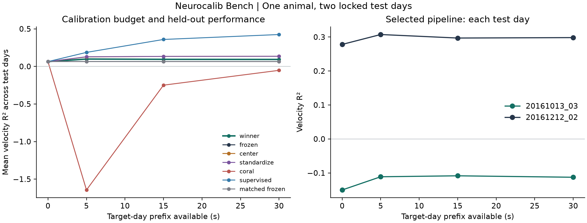

# neurocalib-bench

**Cross-day neural decoding under fixed calibration budgets.**

A small, reproducible study of cross-day intracortical velocity decoding. Compare frozen ridge regression with mean matching, variance matching, regularized covariance alignment, and supervised readout correction under **0, 5, 15, and 30 seconds** of new-day data.

This is an offline, one-animal pilot using public recordings. Its contribution is a controlled experiment and inspectable evidence, with development separated from final testing. It does not claim a new state of the art, clinical validation, or Neuralink replication.

中文概述：固定新日可见数据与校准时间，比较简单适应方法；先冻结协议与配置，再评估保留测试日。保留无收益和负迁移结果。

## Locked pilot results

Eight development candidates were recorded before freezing the final comparison. The selected configuration was strongly shrunk CORAL: `alpha=1`, `lags=10`, `strength=0.25`, `covariance_shrinkage=0.9`. Its development objective was **0.396156956**, compared with **0.383974819** for default frozen ridge.

The table below averages macro x/y velocity R² equally over the **two final-test days and budgets 5, 15, and 30 seconds**, as declared before testing. Zero-budget results remain in the full reports.

| Frozen comparison | Mean test R² |
| --- | ---: |
| Selected shrunk CORAL (`winner`) | 0.095010 |
| Matched frozen / default frozen ridge | 0.064023 |
| Default center | 0.131460 |
| Default standardize | 0.132234 |
| Default full-strength CORAL | -0.648762 |
| Default supervised correction | 0.323263 |

The primary adaptation effect, selected CORAL minus its matched frozen reference, was **+0.030986568 absolute R²**. The development winner did **not** rank first on the test days: cheaper centering and standardization performed better. The winner was retained as selected; it was not replaced after seeing test scores. Supervised correction used velocity labels and is a different information setting.

At a 30-second prefix, the selected unsupervised pipeline still failed on the October test day, with **R² below zero**:

| Test recording | Frozen R² | Selected R² | Supervised R² |
| --- | ---: | ---: | ---: |
| `indy_20161013_03` | -0.150143 | -0.112736 | 0.399160 |
| `indy_20161212_02` | 0.278190 | 0.298256 | 0.449756 |

These are two recording days from one animal. They support a descriptive pilot result, with a clear failure case, rather than a state-of-the-art or population-level claim.



Inspect the [full final JSON](results/final/report.json), [final CSV](results/final/report.csv), [frozen configuration and hashes](results/frozen.json), [eight-candidate summary](results/search_summary.csv), and [complete trial ledger](results/experiments.jsonl). Raw recordings are excluded from the repository.

## Reproduce the experiment

Read the [protocol](PROTOCOL.md) and inspect the [recording manifest](protocol.json). Source training uses two recordings; two more support development; two later recordings are reserved for final evaluation. Every method is scored from 30.5 seconds onward on identical bins.

Python 3.12 and [uv](https://docs.astral.sh/uv/) are required. Core dependencies are NumPy, h5py, Matplotlib, and Pydantic. No GPU or language-model API is required.

From the repository root:

```sh
uv sync --locked
uv run --no-sync python -m neurocalib download
uv run --no-sync python -m neurocalib reproduce
uv run --no-sync python -m neurocalib report
```

`download` retrieves and verifies the six pinned files. `reproduce` recomputes only the saved final configurations and writes [results/reproduced/report.json](results/reproduced/report.json), leaving the original final results intact. Scientific values must match within relative and absolute tolerance `1e-7`; machine-dependent timings are excluded from that comparison. `report` renders the saved original final scores. On a new machine, use `reproduce`: `final` is reserved for the original run and checks its recorded runtime.

Use `uv run --no-sync python -m neurocalib --help` for the complete command list.

Development checks use the same locked environment:

```sh
uv run --no-sync ruff check .
uv run --no-sync ruff format --check .
uv run --no-sync basedpyright
uv run --no-sync python -m unittest discover -s tests -v
```

Local verification passed **23 unittest tests**, lint, formatting, and type checks. CI is configured for Python 3.12 on Ubuntu and Windows. Tests use synthetic HDF5 fixtures and do not download the research recordings. Passing those tests establishes software checks, not evidence for the neuroscience hypothesis.

Full numerical reproduction passed for all seven frozen comparisons: [`matches: true`](results/reproduced/report.json), with relative and absolute tolerance `1e-7`. This verifies a complete local rerun; the remote CI result is not yet available.

## What is being compared

| Method | Information from the new-day prefix |
| --- | --- |
| Zero prediction | None |
| Frozen ridge | None |
| Center | Spike means |
| Standardize | Spike means and variances |
| Regularized CORAL | Spike means and covariance |
| Supervised readout correction | Spikes and velocity labels |

All budgets measure elapsed recording time. Supervised correction receives labels unavailable to the unsupervised methods; equal seconds do not mean equal information. No prefix is selected using movement speed, target identity, or success.

Inputs are M1 channel spike counts in 20 ms bins with at most 400 ms of causal history. Target velocity is in mm/s. A source-only channel-name set is reused across days, with missing channels reported and zero-filled. Prediction follows prefix fitting; this is not a closed-loop cursor experiment.

## Development sanity control

The default frozen decoder uses ridge `alpha=1` and 10 bins of history. Its source-label control circularly shifts the concatenated source velocity labels by half their length before fitting; development labels stay unchanged.

| Development recording | Frozen R² | Shifted-source R² |
| --- | ---: | ---: |
| `indy_20161006_02` | 0.395757204 | -0.002746809 |
| `indy_20161007_02` | 0.372192435 | -0.016684721 |

These are macro x/y R² on the same scoring intervals, not squared correlations. Frozen predictions are identical across calibration budgets. Inspect the [baseline values](results/baseline.json), [baseline CSV](results/baseline.csv), and [source-shift control](results/source_shift_control.json). The deterministic shift is a diagnostic check, not a permutation significance test or final-test evidence.

## AI-assisted research

An external coding agent can follow [program.md](program.md), propose a configuration and hypothesis, run development-only trials, and inspect recorded outcomes. A final freeze binds the selected configuration, scientific code, protocol, and environment before test scores are opened. A fixed parameter sweep is described as a sweep, not autonomous intelligence.

The lifecycle commands are:

```sh
uv run --no-sync python -m neurocalib baseline
uv run --no-sync python -m neurocalib trial --config configs/02_center.json --hypothesis "Prefix mean matching may reduce an additive shift; it may fail when early movement differs from later movement."
uv run --no-sync python -m neurocalib freeze
uv run --no-sync python -m neurocalib final
```

This lifecycle is for an **unfrozen research run**, not a command sequence to rerun on the published final experiment. The published checkout is already frozen and refuses further trials. Search allows at most 12 distinct candidates and selects mean development R² over both days at 5, 15, and 30 seconds. Supervised correction is a fixed reference, excluded from search. All eight attempted candidates, including the failed full-strength CORAL hypothesis, remain in the [experiment ledger](results/experiments.jsonl).

For a new study, create a separate working copy, preserve the original records, and predeclare genuinely untouched test dates. Deleting a freeze and continuing to tune against the same opened test recordings does not create a valid new holdout.

The executable experiment does not host or call an LLM. Raw recordings stay out of Git; derived metrics and provenance form the reviewable output.

## Data and attribution

The six selected files total **635,651,025 bytes**. Downloads must match the sizes and MD5 digests in `protocol.json`.

O'Doherty, J. E., Cardoso, M. M. B., Makin, J. G., and Sabes, P. N. *Nonhuman Primate Reaching with Multichannel Sensorimotor Cortex Electrophysiology*, version 2 (2020). [Dataset and license](https://zenodo.org/records/3854034), DOI [10.5281/zenodo.3854034](https://doi.org/10.5281/zenodo.3854034).

The data and published derived scientific results are **CC BY 4.0**. This repository's software is **MIT**. Attribute the original dataset and the analysis when reusing derived metrics or plots. Cite the original dataset separately from the software; see [CITATION.cff](CITATION.cff).

## Research context

[FALCON](https://proceedings.neurips.cc/paper_files/paper/2024/hash/8c2e6bb15be1894b8fb4e0f9bcad1739-Abstract-Datasets_and_Benchmarks_Track.html) already studies consistent few-shot neural decoding. [NoMAD](https://www.nature.com/articles/s41467-025-59652-y) and [PRI-T](https://www.nature.com/articles/s41551-025-01536-z) provide substantially broader evidence for unsupervised stabilization and recalibration. This repository asks a narrower budget-controlled question; it does not establish superiority over those methods.

Only two final-test days from one animal are included. Report day-level results, negative transfer, measured compute costs, and failed hypotheses. Do not infer population-level significance from autocorrelated 20 ms bins.
