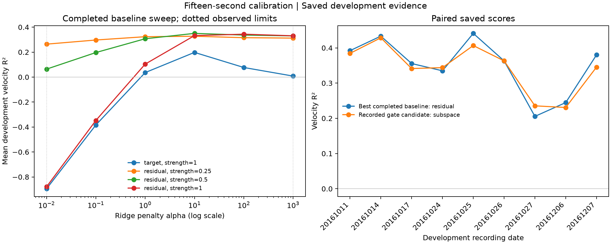

# Fifteen-second supervised calibration

An agent-guided, budget-controlled study of cross-day velocity decoding. The
primary question is whether a small calibration model can beat a strongly tuned
supervised decoder using **the same first 15 elapsed seconds of target labels**.
All comparisons share source-selected causal features and the same scoring suffix.

## Completed development result: gate failed

The amended run completed **24 strong baseline configurations and eight sequential
candidate hypotheses** on all nine development dates. Every method used the same
15-second labeled prefix, shared source preprocessing and scoring rows.

- Frozen source decoder: mean development R² **0.283133339**.
- Best target-only ridge (`alpha=10`): **0.197842152**.
- Best full residual ridge (`alpha=10`, `strength=0.5`): **0.350109462**.
- Best attempted candidate, 32 source PCA directions (`alpha=1`, `strength=0.5`):
  **0.342235344**.

The best candidate-minus-baseline difference was **-0.007874118 absolute R²**,
below the required **+0.02**. Both had **one negative-transfer day out of nine**.
The eight candidates examined output correction, 8/16/32 source directions,
weaker/stronger regularization and larger update strength. Search stopped before
the 12-attempt ceiling because these contrasts did not support further model
expansion. Baseline penalties won inside the expanded range, rather than at its
upper boundary.

**No scheme was frozen and neither animal's final targets were opened.** The
actual `freeze` command rejected the failed decision. No Loco recording was
downloaded or used to choose a method. These are development results after
selection, not independent evidence that a candidate generalizes across animals.

Inspect the [decision](results/decision.json), [stop record](results/stopped.json),
[all 32 terminal trial summaries](results/search_summary.csv), and
[288 daily development rows](results/development.csv). Failed candidates remain
in the complete ledger. A simple supervised residual correction remains the
strongest observed configuration in this study; the small candidate models did
not establish an advantage over it.



The 2016-10-27 prefix occupied only **2/8 direction bins**; all eight other
development prefixes occupied 8/8. Both selected comparisons harmed that day
relative to its frozen decoder. This is one descriptive failure case, with no
replication of low-coverage days, and does not establish that coverage caused the
failure. No date or prefix was discarded because of that observation.

## Research contract

The [protocol](PROTOCOL.md) and [recording manifest](protocol.json) define nine new
Indy development dates, five later Indy final dates, and seven Loco final dates.
Each animal has its own source model and physical-channel set. Loco source data
fit that animal's model only after method selection; they cannot tune the method.
The [agent program](program.md) describes the bounded hypothesis loop.

The shared representation is selected by 30 leave-one-source-day-out settings,
using only the two Indy source days. The chosen setting is 10 history bins
(200 ms), a causal exponential smoother with 60 ms time constant, and source
ridge penalty 10. The [full source-only grid](results/source_tuning.json) includes
all settings, not only the winner.

There are 24 predeclared strong baseline configurations: target-only ridge across
six penalties from 0.01 to 1000, and full residual ridge across those penalties
and update strengths 0.25, 0.5 and 1. Up to 12 agent-proposed candidates may use
six-parameter output correction or source-only PCA residual correction. Candidate
hypotheses and unsuccessful results remain in the [complete ledger](results/experiments.jsonl).

Development advancement requires at least +0.02 absolute mean R² over the strongest
development-selected supervised baseline, with no more negative-transfer days.
Only a passing decision may create a freeze and open final data. Final confirmation
requires animal-macro gain >= +0.02, nonnegative gain in each animal, and no increase
in negative-transfer days in either animal. Negative transfer means worse than
that day's frozen decoder; negative R² is separately a decoding failure.

## Disclosed range amendment

The [initial range diagnostic](../calib15-rangecheck/README.md) completed 18 source
settings and eight baseline configurations. The best source and residual penalties
both reached their search upper bound of 10. It ran no candidates or holdout tests.
Its complete historical source and evidence remain in commit
[`28145bb`](https://github.com/Nigmat-future/neurocalib-bench/commit/28145bb).

Before candidate evaluation, the amended `calib15-v2` broadened the regularization
ranges and tuned residual update strength too. It reruns every baseline in a new
ledger. The amendment was informed by source/development evidence; it is not
preregistration before all development access. Final targets remain untouched by
that decision. Splits, label budgets, candidate limit and advancement threshold
are unchanged.

## Reproduction

From the repository root, with Python 3.12 and the locked uv environment:

```sh
uv sync --locked
uv run --no-sync python -m calib15 download
uv run --no-sync python -m calib15 reproduce
uv run --no-sync python -m calib15 report
```

The default download includes only Indy source and development recordings.
Development reproduction reruns every completed recorded configuration, permits
no new selection, and writes `results/reproduced/development.json`. Scientific
values must match to absolute and relative tolerance 1e-7; elapsed wall time is
excluded. If final testing completed, reproduction instead repeats precisely
the four sealed comparisons; download their data with `download --phase all`.
No GPU or language-model API is required.

All **32 configurations and 288 daily rows reproduced successfully** from a fresh
Git clone of commit `d8d87d6`, using the locked environment and verified local data.
Every scientific row matched with absolute and relative tolerance **1e-7**;
machine wall times were excluded. Inspect the
[complete replay](results/reproduced/development.json) and
[checkout provenance](results/reproduced/checkout.json). Replay added no trial and
read no holdout target. The original and repeated ledgers remain identical.

Software verification passed **61 tests**, Ruff, formatting and strict type
checks. [Ubuntu and Windows CI passed](https://github.com/Nigmat-future/neurocalib-bench/actions/runs/39146578808).
CI uses synthetic HDF5 recordings and lifecycle scenarios; the real-data replay
is separate evidence and does not turn development outcomes into holdout results.

The published source choice, code, dependency lock and protocol are bound by the
first trial's checksums. `prepare` and new trials are for a separately identified
new study, not a way to retune the published evidence. The original six-day pilot
remains independently reproducible with `python -m neurocalib reproduce`.

Reports export [all terminal trial summaries](results/search_summary.csv),
[all daily development values](results/development.csv), and a comparison figure.
These exports read saved evidence only and never open raw recordings. The same
distinction applies to software tests: synthetic correctness does not validate
the biological hypothesis.

## Scope

This is offline natural-movement decoding in two nonhuman primates. Real cursor
velocity is a supervised proxy, not a directly available intention label in a
person with paralysis. Equal elapsed seconds do not imply independent samples.
Five and seven final dates remain only two animals, so population-level or
clinical claims are unsupported. Existing linear adaptation, FALCON, FDA, NoMAD
and TCLA are relevant prior work; these small calibration models are not claimed
as novel algorithms.

Raw and processed data stay outside Git. Recordings and derived scientific results
are CC BY 4.0, with attribution to O'Doherty, Cardoso, Makin and Sabes,
[Zenodo v2](https://zenodo.org/records/3854034); repository code is MIT.
